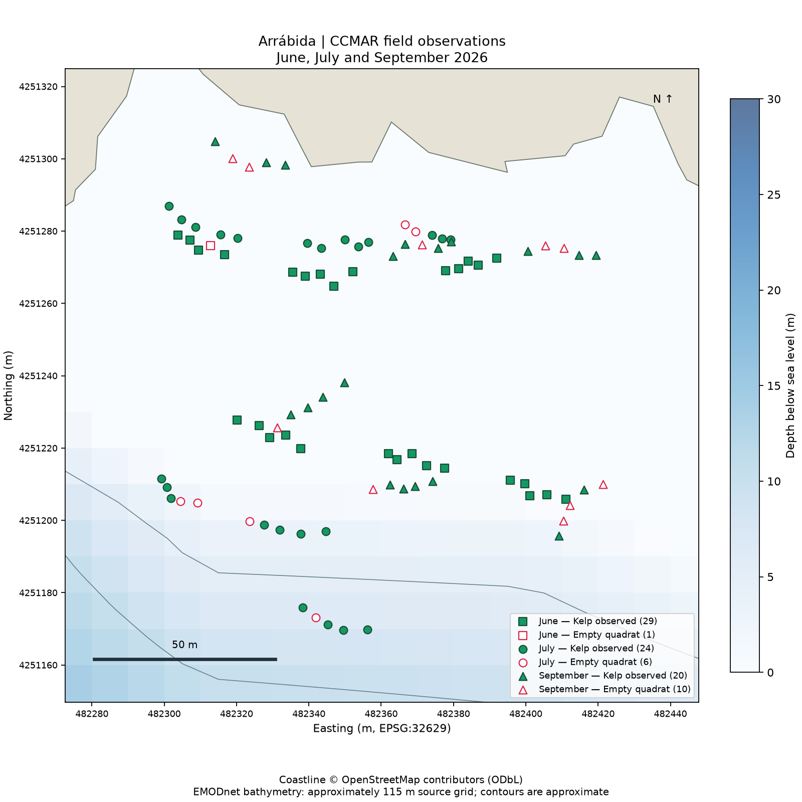
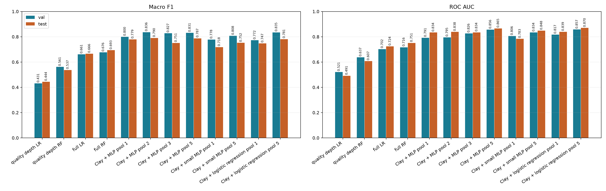
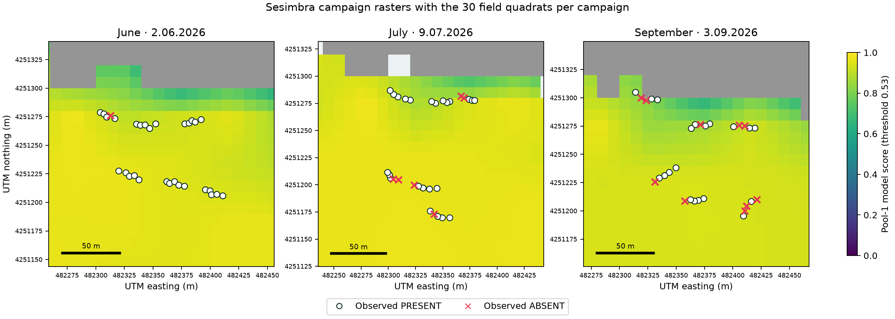

# kelp-observe-classifier

Kelp presence/absence classification for the Arrábida coast near Sesimbra,
Portugal. CCMAR diver observations provide the field reference; Sentinel-2
imagery is classified with frozen Clay v1.5 features and an MLP head.
Pléiades Neo (PNEO), an Airbus optical Earth-observation satellite constellation,
supports separate, finer-resolution exploratory analyses. We use its six-band
multispectral imagery at approximately 1.2 m pixel spacing; see the
[Copernicus product description](https://dataspace.copernicus.eu/explore-data/data-collections/copernicus-contributing-missions/missions/pleiadesneo).

## Sesimbra field dataset

The CCMAR AQUASERV surveys use fixed transects and quadrats at two depth strata.
Each campaign plans three transects per depth, with five quadrats per transect
at 5 m spacing: **30 quadrat positions per campaign**. A survey event is one
quadrat observed on one date; repeated measurements of individual kelp plants
within that event do not create additional independent observations.

The inspected species entries identify **Saccorhiza polyschides**. A quadrat event is **PRESENT** when at least one kelp record is present,
and **ABSENT** when the field record explicitly marks the quadrat empty.
Missing observations are not treated as absences.

*The map shows all 90 survey events: 30 recorded on 2.06.2026 (squares),
30 on 6–7.07.2026 (circles), and 30 on 2.09.2026 (triangles),
at their matched geographic coordinates.
Green indicates kelp observed; hollow red indicates an empty quadrat. The view
is fitted closely around all three campaigns. The vector coastline is from
OpenStreetMap; EMODnet depth contours have approximately 115 m source resolution
and do not resolve depth differences between neighbouring quadrats.*

### Observation dates and counts

The [observation file](../data_collection/sesimbra_field_observations.csv)
contains **90 survey events: 73 PRESENT and 17 ABSENT**, covering June, July and
September. Dates below are those recorded in the measurement workbook.

| Recorded observation date | PRESENT | ABSENT | Total events |
|---|---:|---:|---:|
| 2.06.2026 | 29 | 1 | 30 |
| 6.07.2026 | 10 | 0 | 10 |
| 7.07.2026 | 14 | 6 | 20 |
| 2.09.2026 | 20 | 10 | 30 |
| **Total** | **73** | **17** | **90** |

The measurement and coordinate files sometimes record different dates and
depths for the same transect and quadrat. We matched each observation to one
coordinate record using its transect and quadrat identifiers and the following
explicit date/depth correspondences:

| Measurement record | Coordinate record | Matched events |
|---|---|---:|
| 2.06.2026, 8/15/16 m | Same date and depth | 30 |
| 6.07.2026, 7 m | 7.07.2026, 7 m | 10 |
| 7.07.2026, 7 m | 8.07.2026, 7 m | 5 |
| 7.07.2026, 16 m | 8.07.2026, 17 m | 15 |
| 2.09.2026, 6 m | 1.09.2026, 7 m | 15 |
| 2.09.2026, 15 m | 1.09.2026, 17 m | 15 |

All 90 observations have a unique coordinate match under these rules. The final
file keeps both sources' values: `date` and `depth` come from the measurements;
`gps_date` and `gps_depth_m` come from the coordinate records. This records the
differences without assuming which source has the correct date or depth.

### Projecting observations and assigning pixel labels

Coordinates are represented as longitude/latitude in **WGS84 (EPSG:4326)**.
For each image, they are transformed into the raster's coordinate reference
system, then its affine transform assigns the containing pixel's row and column.
The S2 benchmark and observation map use **WGS84 / UTM zone 29N (EPSG:32629)**;
PNEO sampling reads the CRS and transform from the source JP2 metadata.

A pixel-date pair is one image pixel on one acquisition date. The same pixel
on another date is counted separately. These labels come from the diver
observations, not from model predictions.

| Image source | Image acquisition dates | Pixel labels |
|---|---|---|
| **Pléiades Neo** | 8.07.2026, 3.09.2026 | Each observation labels the approximately 1.2 m pixel containing its coordinates: PRESENT if kelp was recorded, ABSENT if the quadrat was explicitly empty. Every observation falls in a separate pixel within its campaign. Only that pixel receives the label; surrounding pixels used to calculate image features do not receive additional labels. Total: 44 PRESENT, 16 ABSENT pixel-date pairs. |
| **Sentinel-2** | 2.06.2026, 9.07.2026, 3.09.2026 | Within each campaign, observations are grouped by their containing 10 m pixel. A pixel is PRESENT if any observation in it records kelp, and ABSENT only if all observations in it are explicitly empty. Pixels without observations are not labelled. Total: 47 PRESENT, 5 ABSENT pixel-date pairs. None of the selected S2 images has cloud, cirrus or cloud-shadow flags at its campaign's observation locations.  |

Both sensors share one [pixel-date labels file](../data_collection/sesimbra_s2_campaigns/pixel_date_labels.csv),
with the `sensor` column distinguishing PNEO and S2. The file is created by
[this script](../data_collection/sesimbra_s2_campaigns/count_pixel_dates.py).

## Wider training dataset

Training observations come from three public sources, separate from the CCMAR
Sesimbra evaluation surveys:

- [GBIF — Global Biodiversity Information Facility](https://www.gbif.org/what-is-gbif)
  brings together species occurrence records published by research institutions,
  monitoring programmes and other data providers worldwide.
- [OBIS — Ocean Biodiversity Information System](https://obis.org/about/visionmission/)
  provides marine biodiversity records through the IOC-UNESCO ocean-data network.
- [JNCC — Joint Nature Conservation Committee, Marine Recorder](https://jncc.gov.uk/resources/b9934e31-39b6-41f9-9364-d1e93db68307)
  provides UK seabed survey records, including species, habitats and recorded
  absences. We used its public v20220124 snapshot.

The sources overlap, so records are deduplicated by location and observation
date before image selection. PRESENT requires an observed kelp record; ABSENT
requires an explicit absence record, not simply a missing species entry.
Absence candidates contradicted by a nearby kelp observation are excluded.

The species policy supplements the directly observed *Saccorhiza polyschides*
with other European kelps. This is a modelling choice: neither the contribution
of each species nor equal satellite appearance across species has been established.
The [data-collection policy](../data_collection/README.md#sesimbra-species-selection-and-ccmar-evidence)
is the canonical source for the eight-species list, exclusions and supporting
citations. It also documents depth, image-quality and observation-to-image date
filters.

The current three-seed experiment selects two PRESENT chips per eligible ABSENT
chip. The [current counts](../data_collection/README.md#current-experiment-observations-and-s2-pixel-date-labels)
distinguish observations, image chips and native pixel-date labels across seeds.

The [chip manifest](../training/full_nuisance_balance/selected.csv) records each
chip's seed and partition. Different seeds reuse chips. The selected union also supplies the
[final train/validation fitting run](../training/final_models/README.md). Each chip receives a point-derived
label, not a label for every pixel. Several image dates can represent one ABSENT
observation. See the [data-collection README](../data_collection/README.md#current-experiment-observations-and-s2-pixel-date-labels)
for per-seed counts and counting definitions.

See the [data-collection README](../data_collection/README.md) for source references,
species policy, deduplication, absence checks and the full selection protocol.

## Training classifier

### Training, validation and test splits

Each seed (42, 123 and 456) uses **636 chips: 424 PRESENT and 212 ABSENT**.
The [preparation script](../training/prepare_nuisance_pool.py) starts from 984
PRESENT and 214 ABSENT eligible chips. The same central 5×5 quality check for
both labels excludes two ABSENT chips flagged as cloudy, shadowed, missing or
defective. All 212 remaining ABSENT chips are retained.

The [splitter](../training/balance_absent_first.py) first partitions ABSENT groups,
then selects PRESENT chips at exactly 2:1 within each partition. It balances
observation depth and full-chip SCL cloud/shadow/cirrus, missing-data and
saturated/defective fractions. It does not balance spectral brightness, colour,
texture, acquisition dates, processing metadata or SCL land/water fractions.
Independent land-overlap and reliable sunglint measurements remain unavailable.

Exact per-seed counts and the optimization procedure are documented in the
[training methods](../training/README.md#saved-partitions-and-balance-evidence).

Training fits the MLP. Validation is the development set used to select the
checkpoint and threshold; test reports performance after those choices.
The [grouping script](../training/split_groups.py) keeps shared observation IDs,
identical arrays and locations connected within 50 m together, using both
observation and chip-centre coordinates. Scene IDs do not join groups, so the
same acquisition and overlapping 1.28 km chip footprints can cross partitions.
This is location-group evaluation, not evaluation on entirely new scenes.

The [single seed-aware manifest](../training/full_nuisance_balance/selected.csv)
contains the exact assignments. The per-seed CSV/JSON files consumed by the
runner are in [the experiment directory](../training/full_nuisance_balance/).
The [verification script](../training/verify_full_nuisance_trial.py) checks
source features, grouping, ratios, saved checkpoints and validation selection.
The [simpler-head verifier](../training/verify_simple_clay_heads.py) checks the
small MLP and logistic-regression models and their validation choices.

### Models compared

We used [Clay v1.5](https://clay-foundation.github.io/model/), an open-source
foundation model for Earth observation: a neural network pretrained on a large collection
of imagery from multiple satellite and aerial sensors, including Sentinel-2.
It converts an image into numerical feature vectors, called **embeddings**, that
can be used for tasks such as classification. Version 1.5 uses a Vision
Transformer trained partly by reconstructing hidden image patches, allowing it
to learn image patterns without kelp presence/absence labels. Its architecture
and pretraining are described in the [official v1.5 model specification](https://clay-foundation.github.io/model/release-notes/specification.html);
the implementation is available in the [Clay source repository](https://github.com/Clay-foundation/model).

We use Clay v1.5 as a **frozen feature extractor**: its pretrained weights remain
unchanged during our experiments. A separate classifier, called the **head**,
learns to map those features to PRESENT or ABSENT using our labelled chips.
This lets us reuse Clay's learned image features while fitting far fewer
parameters than retraining the full network.

The full-chip runs use six Sentinel-2 bands (B02, B03, B04, B05, B08 and B11), resizing each 128×128
chip to 224×224 and applying the saved band normalization. Encoder GSD is
derived as `10 × 128 / 224 ≈ 5.714 m`, retaining the 1,280 m ground footprint. Geographic and seasonal
encodings are zero. Depth is used for data selection and split balancing, but is
not an input to the Clay heads.

A head receives the global image token together with the mean of a central
square of patch tokens. **Pool 1, 2, 3 or 5** means a 1×1, 2×2, 3×3 or 5×5
square of tokens. All tokens can use the full image context; pool 1 does not
mean that the model sees only one original Sentinel-2 pixel.

The current comparison trains the original MLP (2048 → 512 → 128 → 1) for
pools 1, 2, 3 and 5, with three seeds each. It also fits logistic regression and
random-forest baselines on whole-chip image statistics, depth, quality flags,
and their combinations. The comparison also includes logistic regression
(2,049 parameters) and a small MLP (2048 → 32 → 1; 65,601 parameters) on the same
Clay embeddings, for pools 1 and 5. The small MLP is a neural-network classifier
with one hidden layer of 32 units. It uses the same embeddings as the larger MLP
but has fewer trainable parameters, allowing us to test whether a simpler
classifier works better with this small dataset. Their regularization is chosen
on validation.

Relevant scripts: [Clay runner](../training/train_frozen_sesimbra.py),
[MLP and loss](../training/model_head.py),
[simpler Clay heads](../training/train_simple_clay_heads.py), [pooling](../training/patch_pool.py),
[whole-chip feature preparation](../training/prepare_nuisance_pool.py),
[baseline runner](../training/run_location_baselines.py) and its
[shared fitter](../training/baselines.py),
and [report/plot builder](../training/summarize_full_nuisance_trial.py).

### Results

The linked comparison tables report three-seed means on the same 50 m grouped partitions.

#### Baselines and possible confounders

**LR (logistic regression)** learns a linear decision rule from the supplied
features and converts its output to a PRESENT probability. **RF (random forest)**
combines many decision trees and can capture nonlinear relationships between
features. In the baseline tables, their inputs are whole-chip band statistics or
depth and quality measurements. **Clay + logistic regression** is a different
model: its inputs are the frozen Clay embeddings, not those image statistics.

The image baseline uses whole-chip mean, standard deviation, 10th and 90th
percentiles and their difference for each of the six bands used by Clay.
These spectral statistics are predictors, not variables used for balancing.
The nuisance baseline uses depth and the three whole-chip quality fractions.
Preprocessing is fitted on training data only; baseline hyperparameters and the
0.5 decision threshold are fixed.

The [comparison report](../training/full_nuisance_balance/README.md#selection-and-baselines)
contains the complete baseline metrics.

The nuisance and whole-chip image baseline scores are regenerated in the
[comparison report](../training/full_nuisance_balance/README.md). Compare nuisance
predictiveness against the always-PRESENT Macro F1 of 0.400 at the 2:1 ratio.
Image-baseline predictiveness can include kelp signal, habitat or contamination
effects; these checks do not establish the absence of confounding.

#### Clay classifiers with 50 m location groups

The reported comparisons use validation-selected decision thresholds. Checkpoints maximize
validation Macro F1 at threshold 0.5; thresholds then maximize validation Macro
F1 over 0.05–0.95. Test scores do not select checkpoints or thresholds.

The [classifier results](../training/full_nuisance_balance/README.md#classifier-results)
and [simpler-head results](../training/full_nuisance_balance/README.md#simpler-clay-heads)
contain the complete metric tables on the same partitions.

The complete validation and test rankings are given in the linked reports;
model settings and thresholds are selected using validation only.

[Clay results](../training/full_nuisance_balance/clay_full_sweep/metrics.csv),
[simpler-head results](../training/full_nuisance_balance/simple_heads/metrics.csv),
[baseline results](../training/full_nuisance_balance/baseline_metrics.csv) (use
`variant=balanced`), and [the full report](../training/full_nuisance_balance/README.md)
provide per-seed and per-class metrics. The [plot builder](../training/summarize_full_nuisance_trial.py)
reproduces the figure from those saved results.

#### Small dataset and overfitting

Each seed has only a few hundred training chips, with images from several acquisition dates for some ABSENT field
observations. These are different images, not duplicate acquisitions: one field
observation can label up to eight image dates within ±30 days. They share the
same field evidence and location, so they remain in the same partition. The MLP has approximately 1.1 million trainable parameters even
though Clay is frozen. The [comparison report](../training/full_nuisance_balance/README.md)
shows the train/validation/test gap for each head and pool. Train–validation gaps must be considered when assessing possible overfitting. Small differences between heads are exploratory and do
not establish a reliable ranking across new sites.

Seeds reuse observations; they are not independent datasets.
Shared scenes, overlapping footprints and repeated inspection of test results
also limit interpretation. These are exploratory results, and a larger dataset is needed before claiming generalization.

#### Train final models

The final fit retains the complete selected union and trains the small MLP with
pool 5 and the original MLP with pool 1 on a shared grouped train/validation
split. It balances depth and whole-chip quality while retaining all chips.
The time-limited optimizer found a feasible solution, without establishing
global optimality.

The [final-model report](../training/final_models/README.md) is the canonical
record of partition counts, training settings, selected epochs, thresholds,
metrics and measured balance. Validation selects checkpoints and thresholds;
these scores are fitting diagnostics on previously explored observations,
not independent test results.

### Checkpoints and reproduction

The two final classifier checkpoints are included under `training/final_models`.
Comparison checkpoints, the pretrained Clay backbone and embeddings remain
external inputs. The
[reproduction guide](REPRODUCIBILITY.md) owns environment setup, configuration
and ordered commands, including a [CPU inference example](REPRODUCIBILITY.md#predict-from-saved-embeddings).
The [final-model catalog](../training/final_models/model_manifest.json) records
checkpoint paths and hashes; the [final-model report](../training/final_models/README.md#reproduction-and-reuse)
explains the saved interface. New imagery must use the same frozen encoder and
preprocessing.

## Application to Sesimbra observations

We applied the two final models to separate Sentinel-2 images for each campaign:
2.06.2026 for June, 9.07.2026 for July and 3.09.2026 for September. The 90 field
observations produce 52 distinct labelled pixel-date pairs: 47 PRESENT and
5 ABSENT. A pixel containing both labels is PRESENT under the aggregation rule
above. June therefore has no ABSENT pixel labels.

The [evaluation script](../training/evaluate_sesimbra_campaigns.py) extracts one
128×128 chip centred on each labelled pixel and encodes the whole chip using
the training preprocessing. The [chip manifest](../training/sesimbra_evaluation/chip_manifest.csv)
records scene, location, extraction indices, quality flags and array hashes.
All 52 chips are evaluated; 47 pass the training central-water check. Neither
model nor its validation-selected threshold is adjusted using these field labels.

The [campaign report](../training/sesimbra_evaluation/README.md#observation-centred-predictions)
contains the complete centred-chip metrics and campaign raster comparison.

The field evaluation classifies all 52 labelled pixel-dates as PRESENT with
both heads and the pool-1 raster: 47 true positives and five false positives.
Macro F1 is 0.475 and ABSENT recall is zero, matching the always-PRESENT baseline.
This does not demonstrate presence/absence discrimination at Sesimbra. Only five ABSENT pixel-dates and closely spaced quadrats limit
the evaluation and any inference about wider deployment.
See the [predictions](../training/sesimbra_evaluation/predictions.csv),
[results](../training/sesimbra_evaluation/metrics.csv) and
[Sesimbra campaign observations prediction](../training/sesimbra_evaluation/README.md).

### Pool-1 prediction maps

The same evaluation script runs the pool-1 head over every patch token in
40 overlapping full-chip windows per campaign. It resizes patch scores to the
native 10 m grid and averages overlapping predictions. This creates a continuous
map, but does not establish independent 10 m resolving power. Raster scores can
differ from scores obtained with a chip centred on the observation.

White circles mark observed PRESENT quadrats; red crosses mark observed ABSENT
quadrats. Grey indicates SCL land classes. The displayed raster retains water
and unclassified pixels; other classes are masked. No depth clipping is applied.
Each panel shows all 30 field quadrats, while evaluation counts distinct labelled
pixels only. Thresholds and campaign-specific scores are read from the saved
checkpoints and predictions in the [campaign report](../training/sesimbra_evaluation/README.md).
June two-class Macro F1 is omitted because its labels are all PRESENT.

[June raster](../training/sesimbra_evaluation/june/pool1_probability.tif),
[July raster](../training/sesimbra_evaluation/july/pool1_probability.tif),
[September raster](../training/sesimbra_evaluation/september/pool1_probability.tif).
The [map/report script](../training/report_sesimbra_campaigns.py) creates the figure;
the [verification script](../training/verify_sesimbra_campaigns.py) checks source
crops, saved-head replay, raster reconstruction, masks and metrics.
External chip and embedding arrays are described under `SESIMBRA_EVALUATION_DIR`
in [example_config.json](../example_config.json).

## September Pléiades Neo analysis

The PNEO image acquired on 3.09.2026 supports a separate exploratory analysis of
the 30 quadrats observed on 2.09.2026: 20 PRESENT and 10 ABSENT. We use the
spectral features and Clay embeddings and check their labels
and coordinates against the matched observation file.

We compare six-band statistics from 5×5 native-pixel windows, Lyzenga indices
(logarithmic band combinations intended to reduce water-depth effects), and
Clay embeddings. Each feature set feeds a PNEO-specific logistic regression.
Evaluation holds out one depth-by-transect group at a time, giving six folds;
scaling is fitted on the remaining five groups and the threshold stays at 0.5.
These are separate exploratory classifiers, not the two final Sentinel-2 heads.

Feature definitions, preprocessing, classifier settings and citations are
maintained in the [PNEO section of the campaign report](../training/sesimbra_evaluation/README.md#september-pléiades-neo-analysis).

Always predicting PRESENT gives Macro F1 0.400. The best feature set here reaches
0.525, but this small, exploratory comparison uses adjacent transects from one
image, with overlapping image windows. It does not establish performance at a
new location. Within-transect feature comparisons also provide no significant
separation after correction for multiple tests.

See the [September PNEO analysis in the campaign report](../training/sesimbra_evaluation/README.md#september-pléiades-neo-analysis),
[results](../training/pneo_september/metrics.csv),
[feature extraction code](../training/extract_pneo_september.py) and
[evaluation code](../training/evaluate_pneo_september.py). Licensed source imagery
is supplied externally through [config](../example_config.json); no PNEO RGB
background is included in the maps.

## Additional unresolved assumptions

Explicit taxon-level non-detection does not establish absence of every target
kelp. The pooled ABSENT class can include surveys whose full taxonomic scope
and detection completeness are unknown. Excluding nearby recorded presence
removes known contradictions, but missing presence records are not evidence of
absence. See [GBIF survey-data guidance](https://docs.gbif.org/guide-publishing-survey-data/en/).
This uncertainty remains in the current labels.

Acquisition can snap an observation to an SCL water pixel up to 300 m away
when regional water QC fails. Although the displacement is recorded, the original
field label is not independently verified at that displaced position. This is
additional label-location uncertainty beyond the reported coordinate uncertainty;
it can affect both classes. Field evaluation uses unsnapped observations.

PNEO water statistics and Lyzenga coefficients are estimated from the full image,
including the held-out transects' unlabelled image context. Thus its evaluation
measures within-scene transfer with shared preprocessing, not transfer to an
unseen scene. Different normalization and geographic/time encodings also mean the
PNEO and S2 Clay results are not a controlled sensor-only comparison.

The S2 downloaders retain source digital numbers before the recorded Clay
normalization. Asset scale/offset and processing-baseline conventions have not
been audited across the entire training collection and field images. Saved
campaign metadata contains both an offset-applied flag and nonzero asset offset
metadata; their interpretation must be checked against actual asset values and
the encoder's expected input convention. See [Earth Search's radiometry guidance](https://github.com/Element84/earth-search).
This is an unresolved consistency risk, not a confirmed correction to apply.
No radiometric transformation is assumed without a separate audit.

The [acquisition procedure](../chip_generation/README.md#complete-footprints-and-overlapping-tiles)
requires complete source coverage and preserves the requested projected grid
when an overlapping tile supplies it. Every accepted array must pass the same
quality rules. Coverage does not establish radiometric consistency or biological
label accuracy, and live STAC assets may change independently of saved hashes.
