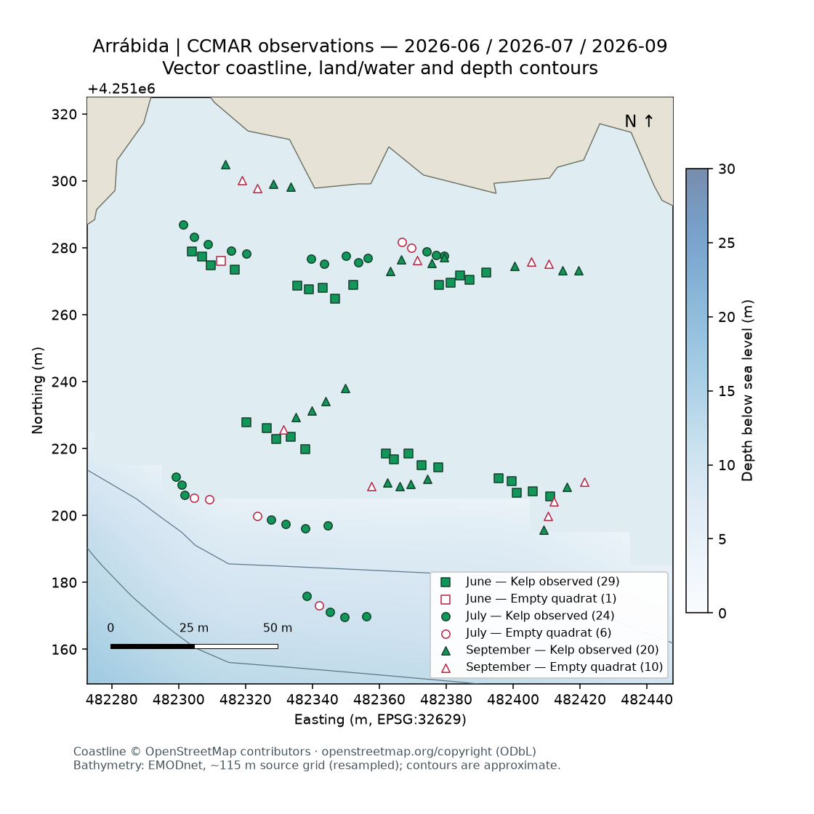
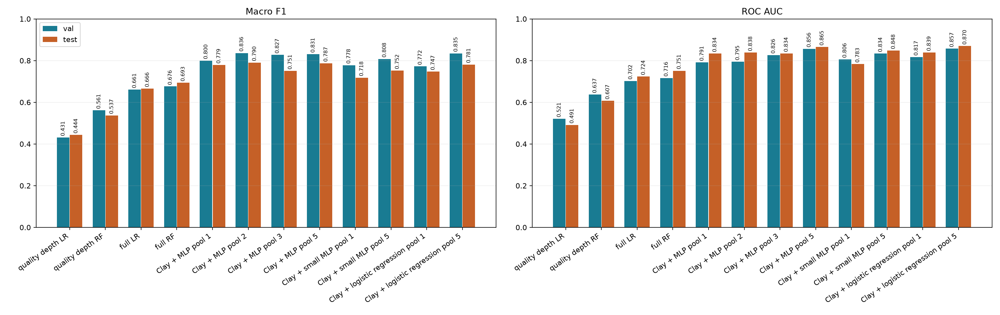
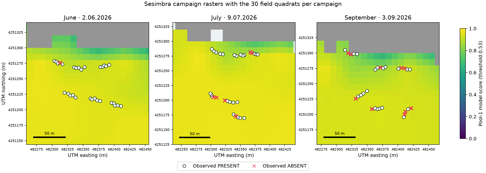
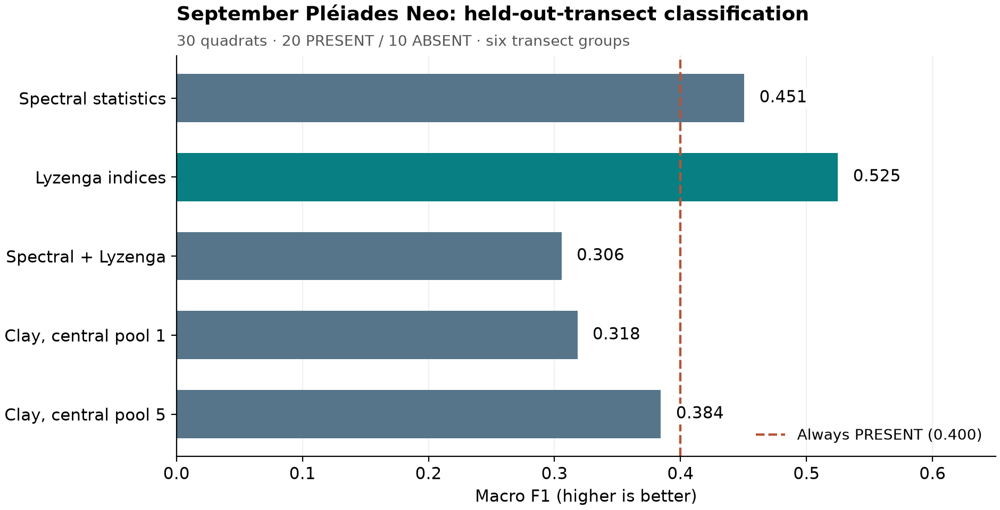

# Satellite detection of coastal kelp: evidence from European observations and field surveys at Sesimbra, Portugal

**Technical study report — 16 October 2026**

## Abstract

This study examines whether satellite imagery contains information useful for distinguishing kelp presence from recorded absence, and whether models trained on wider European observations transfer to the Arrábida coast near Sesimbra, Portugal. Public biodiversity records supplied training labels, while CCMAR AQUASERV diver surveys provided a separate local field evaluation. Sentinel-2 imagery was analysed using conventional image statistics and features from the frozen Clay v1.5 Earth-observation foundation model. A separate Pléiades Neo analysis examined finer-resolution imagery using spectral statistics, water-column-adjusted indices and Clay features.

Each of three Sentinel-2 comparisons included 636 image samples, with two PRESENT samples for every ABSENT sample. Clay classifiers achieved mean test Macro F1 scores of 0.718–0.790, compared with 0.666–0.693 for simple image-statistic classifiers and 0.400 for always predicting PRESENT. These results support the presence of a kelp-associated image signal, although they do not isolate the contribution of kelp from correlated habitat and acquisition conditions. Transfer to Sesimbra was unsuccessful for absence detection: both final models classified all 52 labelled Sentinel-2 pixel-date observations as PRESENT. In the September Pléiades Neo analysis, water-column-adjusted indices achieved Macro F1 of 0.525, but no individual feature remained statistically significant after adjustment for multiple comparisons.

The principal limitation is the small and uneven field evidence, especially the scarcity of independently observed ABSENT locations. The 212 ABSENT training images represent only 51 location–observation-date records, and the Sesimbra evaluation contains only five ABSENT Sentinel-2 pixel-date labels. The results justify further investigation of the kelp-associated signal, but do not yet establish reliable operational presence/absence mapping.

## 1. Background and objectives

Satellite observations could extend field-based kelp monitoring across larger coastal areas and repeated dates. For submerged kelp, however, the measured image signal combines vegetation, water-column effects, seabed properties and coastal context. A useful classifier must distinguish kelp from environmentally similar places where it is absent, rather than simply identify shallow or vegetated coastal habitats. Multispectral methods for separating water-depth and bottom effects have a long history, including the approach proposed by [Lyzenga (1978)](https://doi.org/10.1364/AO.17.000379).

The target setting is the Arrábida coast near Sesimbra. The named kelp in the inspected local field observations is *Saccorhiza polyschides*. Wider European kelp records were used to increase the available training evidence. This broader species grouping is a modelling assumption: ecological similarity and occurrence in comparable habitats do not establish identical satellite appearance. Portuguese kelp surveys provide relevant regional context, including the [Findkelp study](https://sapientia.ualg.pt/entities/publication/870b80f6-491a-4ada-8015-f2f932475461).

The study addressed four questions:

1. Can satellite image features distinguish recorded kelp presence from absence in a wider European dataset?
2. Do learned Earth-observation features improve on simpler spectral and environmental predictors?
3. Do these models distinguish presence and absence in separate Sesimbra field observations?
4. Does finer-resolution Pléiades Neo imagery provide complementary evidence at the scale of local transects?

The study evaluates classification of point-derived labels. It does not estimate kelp biomass, percentage cover, species identity or total kelp-forest area.

## 2. Observations and imagery

### 2.1 European biodiversity observations

Training observations were assembled from the Global Biodiversity Information Facility (GBIF), the Ocean Biodiversity Information System (OBIS), and the Joint Nature Conservation Committee's Marine Recorder public UK snapshot dated 24 January 2022. These sources combine records from multiple surveys and institutions; they overlap and therefore cannot be treated as independent collections. Relevant source descriptions are available from [GBIF](https://www.gbif.org/what-is-gbif), [OBIS](https://obis.org/about/visionmission/) and [JNCC](https://jncc.gov.uk/resources/b9934e31-39b6-41f9-9364-d1e93db68307).

Records were deduplicated by class, location and calendar date. Observations required valid coordinates and a complete date from 1 January 2016 onward. PRESENT observations with reported coordinate uncertainty greater than 10 m were excluded; observations with unknown uncertainty were retained. No equivalent uncertainty cutoff was imposed on the much smaller ABSENT class. Unknown uncertainty must not be interpreted as accurate positioning.

PRESENT meant that kelp was observed. ABSENT required an explicit absence record; a species missing from a list was not automatically considered absent. An absence contradicted by a recorded kelp presence within 10 m and five days was excluded. This reduces known contradictions but cannot establish that every absence survey searched completely for every target kelp. Survey scope and sampling effort remain relevant to the interpretation of non-detection, as discussed in [GBIF's survey-data guidance](https://docs.gbif.org/guide-publishing-survey-data/en/).

The PRESENT species group comprised *Saccorhiza polyschides*, *Laminaria ochroleuca*, *Phyllariopsis brevipes*, *Phyllariopsis purpurascens*, *Undaria pinnatifida*, *Laminaria hyperborea*, *Saccharina latissima* and *Alaria esculenta*. No qualifying source observations were available for *P. purpurascens*. Southern-European species supplied regional comparisons, while additional European kelps broadened the available examples. Ecological work documents similarities, as well as important differences, between annual canopy-forming species such as *Undaria* and *Saccorhiza* ([Epstein, Hawkins and Smale, 2019](https://pmc.ncbi.nlm.nih.gov/articles/PMC6584561/)). The contribution of each species to classification performance was not separately established.

After source, uncertainty, species and absence-consistency filtering, the candidate collection contained **8,275 PRESENT and 219 ABSENT location-date observations**. These are candidates before imagery and depth filtering, not the final number of training samples.

### 2.2 Sesimbra field surveys

CCMAR AQUASERV surveys used fixed transects and quadrats in two depth strata. Each campaign comprised three transects per depth stratum and five quadrats per transect, spaced approximately 5 m apart. This gave 30 quadrat observations per campaign. Repeated measurements of individual plants within a quadrat did not create additional survey events.

The three campaigns produced **90 survey events: 73 PRESENT and 17 ABSENT**. A quadrat was PRESENT if at least one kelp record was recorded and ABSENT if the field record explicitly identified it as empty. Missing observations were not converted to absences.

| Campaign | Recorded field date(s) | PRESENT events | ABSENT events | Total |
|---|---|---:|---:|---:|
| June | 2 June 2026 | 29 | 1 | 30 |
| July | 6–7 July 2026 | 24 | 6 | 30 |
| September | 2 September 2026 | 20 | 10 | 30 |
| **Total** | | **73** | **17** | **90** |

Measurement and coordinate records sometimes differed in their recorded dates or depth assignments. All 90 events were matched one-to-one using campaign, transect and quadrat information, with explicit date/depth correspondences. Both sources' values were retained. A successful match resolves which records belong together; it does not remove uncertainty in their recorded position, date or depth.

*Figure 1. CCMAR field observations along the Arrábida coast. Marker shapes distinguish campaigns; green indicates observed kelp and hollow red indicates an empty quadrat. All 90 survey events are shown, including repeated nearby positions. The coastline is derived from OpenStreetMap and the background depth contours from EMODnet. The approximately 115 m bathymetric source resolution does not resolve differences between adjacent quadrats.*

### 2.3 Satellite imagery and observation scale

Sentinel-2 Level-2A imagery supplied the main classification inputs. Six spectral bands represented blue, green, red, red edge, near infrared and shortwave infrared information. Analysis used a 10 m grid, although the red-edge and shortwave-infrared bands used here have native 20 m resolution. Resampling aligns the bands but does not create additional spatial information ([Copernicus Sentinel-2 mission specification](https://sentiwiki.copernicus.eu/web/s2-mission)).

**Acceptance filters for Sentinel-2 training images.** Each sample comprises a 128 × 128-pixel image on a 10 m grid, covering 1.28 × 1.28 km. The regional checks below use the central 23 × 23 pixels; the stricter centre checks use the central 5 × 5 pixels. Cloud, shadow, water and missing-data classes are determined from the Sentinel-2 scene-classification layer (SCL).

- **Temporal correspondence.** The absolute difference between image acquisition and observation date must be at most **10 days for PRESENT** and **30 days for ABSENT**.
- **Sampling frequency.** Retain at most **one accepted image per PRESENT observation** and **eight accepted image dates per ABSENT observation**, with no more than one accepted image per calendar day for an observation.
- **Scene-level cloud screening.** The catalogue-reported cloud cover of the complete satellite scene must be **less than 60%**. This is an initial screening condition; it does not replace the local image-quality checks.
- **Complete spatial coverage.** All acquired bands must cover the full requested footprint. An incomplete raster window is rejected rather than stretched to fill the sample. A fully covering overlapping tile may supply the footprint only from the same acquisition, with matching processing and radiometric conventions; the requested ground grid is preserved.
- **Regional cloud and shadow.** Within the central 23 × 23 pixels, the combined fraction classified as cloud, cirrus or cloud shadow must be **no greater than 40%**.
- **Regional water coverage.** At least **30%** of the central 23 × 23 pixels must be classified as water.
- **Regional data availability.** Missing-data pixels must occupy **no more than 70%** of the central 23 × 23 region.
- **Regional spectral variation.** Among nonzero blue-band values in that region, the difference between the 95th and 5th percentiles must be **at least 30 digital-number units**, calculated from **at least 21 nonzero pixels**. This rejects nearly uniform or inadequately populated samples; it is not an independent cloud test.
- **Central water and signal validity.** At least **24 of the 25 central pixels** must be classified as water and have blue- and green-band digital numbers **greater than 10**.
- **Central training-quality exclusion.** Before balancing, reject any sample containing even one central 5 × 5 pixel classified as missing, saturated/defective, cloud shadow, cloud or cirrus. This additional exclusion applies identically to PRESENT and ABSENT.

A spatial fallback is permitted only when no unshifted candidate passes and a candidate fails the regional water criterion. The sampling position may then move to the nearest eligible water pixel within **300 m**; the resulting image must pass the quality checks again. The displacement is recorded. This fallback does not independently verify the original field label at the shifted position.

**Additional training-eligibility criteria** concern the observation and its associated image, rather than image quality alone:

- **Depth:** the estimated observation depth must lie between **0 and 20 m below sea level, inclusive**, and the depth estimates must disagree by **no more than 1 m**.
- **Label consistency:** observations with ambiguous training labels are excluded. Identical image arrays are deduplicated while retaining their observation associations.

The eligible collection before the final central training-quality exclusion contained **1,198 samples: 984 PRESENT and 214 ABSENT**. That exclusion removed two ABSENT samples, leaving **1,196 candidates: 984 PRESENT and 212 ABSENT** for balancing. Multiple acquisition dates at one observation do not constitute additional independent field evidence.

These filters define the training collection. For the separate Sesimbra field evaluation, all 52 labelled pixel-dates were retained, including those failing the training central-water criterion; field observations were not shifted to water.

Local Sentinel-2 images were acquired on 2 June, 9 July and 3 September 2026. Multiple quadrats can occupy the same 10 m pixel. A campaign pixel was labelled PRESENT if any observed quadrat in it contained kelp; it was ABSENT only if every observed quadrat in that pixel was empty. This rule produced **52 labelled pixel-date pairs: 47 PRESENT and five ABSENT**.

| Campaign | Sentinel-2 image date | PRESENT pixel-dates | ABSENT pixel-dates | Total |
|---|---|---:|---:|---:|
| June | 2 June 2026 | 17 | 0 | 17 |
| July | 9 July 2026 | 16 | 2 | 18 |
| September | 3 September 2026 | 14 | 3 | 17 |
| **Total** | | **47** | **5** | **52** |

Pléiades Neo supplied a separate finer-resolution comparison. Its six-band multispectral imagery has approximately 1.2 m pixel spacing, distinct from the 0.3 m panchromatic product ([Copernicus Pléiades Neo description](https://dataspace.copernicus.eu/explore-data/data-collections/copernicus-contributing-missions/missions/pleiadesneo)). July and September imagery together supported 60 distinct observation pixel-dates, with 44 PRESENT and 16 ABSENT labels. The classification experiment reported here used only the **September subset: 30 quadrats, comprising 20 PRESENT and 10 ABSENT**, paired with imagery acquired one day after the survey.

## 3. Analytical approach

### 3.1 Partitioning and environmental balance

The Sentinel-2 comparison used three partition realizations, identified by seeds 42, 123 and 456. Partition construction followed an **ABSENT-first procedure**: allocate the eligible ABSENT groups to training, validation and test, then select and assign PRESENT samples to match them within each partition.

**Variables used for environmental balance:**

- **Observation depth:** estimated depth in metres, restricted to the eligible 0–20 m range.
- **Cloud/shadow fraction:** the proportion of the complete 128 × 128 image classified as cloud, cirrus or cloud shadow.
- **Missing-data fraction:** the proportion of the complete image classified as missing data.
- **Saturated/defective fraction:** the proportion of the complete image classified as saturated or defective.

Unlike the central acceptance filters, these quality fractions describe the **whole image footprint**. Passing the central checks does not require the surrounding image to be entirely free of quality flags.

**Partitioning constraints and matching criteria:**

1. **Group integrity.** Samples sharing an observation identity or an identical image belong to the same group. Locations within **50 m** are also connected, using both observation and image-centre coordinates. Connections are transitive: linked chains remain together. Groups are defined across both classes, and selected members of a group cannot appear in different partitions.
2. **Complete ABSENT retention.** All **212 eligible ABSENT images** must be retained. Their whole groups are assigned first, with nominal training/validation/test targets of **70% / 15% / 15%**. To accommodate group sizes, the lower count bounds are the targets rounded down minus **10, 5 and 5 ABSENT images**, respectively; upper bounds are the targets rounded up plus those allowances. Each partition must contain at least **five ABSENT groups**. The target percentages are therefore approximate, not fixed achieved proportions.
3. **ABSENT representativeness.** Assignment seeks to make each partition's ABSENT distributions resemble those of the complete eligible ABSENT collection for the four balancing variables. The search penalizes both average and worst distribution differences, with a smaller penalty for deviation from target counts.
4. **Exact within-partition class ratio.** Once ABSENT assignments are fixed, PRESENT samples are selected so that **PRESENT count = 2 × ABSENT count separately in training, validation and test**. Each image can be selected at most once per realization. A PRESENT sample in a group already assigned through ABSENT members may only enter that group's partition.
5. **Within-partition environmental matching.** PRESENT selection minimizes differences from ABSENT in standardized feature means and cumulative distributions. Comparing cumulative distributions assesses the fraction of observations below successive feature values, rather than matching only the mean. The objective also penalizes the largest distribution discrepancies. Corresponding depth terms receive **threefold weight**, cloud/shadow terms **1.5-fold weight**, and the other quality terms unit weight. Training, validation and test receive equal priority in this matching objective.
6. **Separation from classifier fitting.** Classifier predictions and performance scores do not determine which images enter a partition. The same selected images and assignments are used for all compared classifiers. Nevertheless, environmental measurements from the full candidate pool inform balancing, so this is a designed comparison rather than an independently sampled external test.

The resulting counts were:

| Realization | Training PRESENT / ABSENT | Validation PRESENT / ABSENT | Test PRESENT / ABSENT | Total images |
|---|---:|---:|---:|---:|
| Seed 42 | 280 / 140 | 70 / 35 | 74 / 37 | 636 |
| Seed 123 | 280 / 140 | 74 / 37 | 70 / 35 | 636 |
| Seed 456 | 280 / 140 | 74 / 37 | 70 / 35 | 636 |

Each realization therefore contains **424 PRESENT and 212 ABSENT images**. Each training partition has 420 images, while validation and test have 105 or 111. Environmental balance is an optimized approximate match, not a requirement for identical distributions or a guarantee of a globally optimal allocation. Relationships between balancing variables are not explicitly matched. Spectral brightness, colour, texture, acquisition date and processing metadata are not balancing variables; land/water mixture and sunglint are not comprehensively controlled. Grouping also does not exclude shared satellite scenes or overlapping parts of the broader image footprint across partitions.

The three realizations reused observations and therefore are not three independent studies. Their combined selected collection contained **725 unique images: 513 PRESENT and 212 ABSENT**. The ABSENT images represented only **51 location–observation-date records at 48 distinct recorded coordinate positions**, using the same coordinate rounding as source deduplication. These positions are not necessarily 48 ecologically independent sites.

### 3.2 Sentinel-2 classifiers

Three types of predictors were compared. Environmental baselines used depth and image-quality measurements. Conventional image baselines used summaries of spectral brightness and variation across each image. Clay-based classifiers used learned image features from the pretrained [Clay v1.5 model](https://clay-foundation.github.io/model/release-notes/specification.html), using the [official Clay implementation](https://github.com/Clay-foundation/model).

Clay remained frozen throughout the study: only the classifier attached to its features was trained on kelp labels. This reduces the amount of task-specific learning required. Clay represents each input image as a grid of learned feature vectors, called **patch tokens**, and a separate whole-image summary, called the **CLS token**. For the Sentinel-2 inputs used here, the patch features form a 28×28 grid.

**Central pooling** averages the feature vectors in a square around the central observation. The pool number specifies the side length of that square in tokens:

- **Pool 1:** use one central patch token.
- **Pool 2:** average a central 2×2 square of **4 tokens**.
- **Pool 3:** average a central 3×3 square of **9 tokens**.
- **Pool 5:** average a central 5×5 square of **25 tokens**.

Each Clay-based classifier receives the pooled central feature vector concatenated with the whole-image summary. Pooling therefore averages learned features, not pixel values or classifier predictions. A larger pool summarizes a wider central area, while the length of the resulting feature vector remains the same.

The pool numbers refer to **feature tokens, not satellite pixels**. Clay processes the entire image before central pooling, so each token can contain information from the surrounding image. Pool 1 consequently does not restrict the model to one native 10 m pixel, and changing the pool size neither changes the original image footprint nor establishes finer spatial resolution.

The classifiers were:

- **Logistic regression (LR).** Implemented with scikit-learn’s [LogisticRegression](https://scikit-learn.org/stable/modules/generated/sklearn.linear_model.LogisticRegression.html). A linear classifier that learns a weighted combination of the input features and converts it into a score for kelp presence. It was applied to environmental measurements, image statistics and Clay features. With the 2,048 Clay features, it has **2,049 fitted parameters**, including the intercept. It provides a simple comparison against the neural networks.
- **Random forest (RF).** Implemented with scikit-learn’s [RandomForestClassifier](https://scikit-learn.org/stable/modules/generated/sklearn.ensemble.RandomForestClassifier.html). An ensemble of decision trees that combines their predictions to capture nonlinear relationships between features and kelp occurrence. The study used 120 shallow trees for the environmental and image-statistic baselines. This tests how much discrimination is possible without a pretrained image representation.
- **Larger neural network (MLP).** A multilayer perceptron: a classifier that passes the input features through successive layers of learned weighted combinations and nonlinear transformations. It receives 2,048 Clay features, has two hidden layers with 512 and 128 units, and produces one output score. It contains **1,114,881 trainable parameters** (approximately 1.1 million). This flexibility allows complex feature relationships, but also creates a substantial risk of overfitting with only a few hundred training images.
- **Smaller neural network (small MLP).** A simpler version using the same 2,048 Clay features, one hidden layer with 32 units, and one output score. It contains **65,601 trainable parameters**, approximately 17 times fewer than the larger network. It tests whether reducing classifier complexity improves performance with the limited labelled dataset.

Both neural networks were assembled from standard PyTorch components: [Linear layers](https://pytorch.org/docs/2.4/generated/torch.nn.Linear.html) arranged in a [Sequential model](https://pytorch.org/docs/2.4/generated/torch.nn.Sequential.html), with nonlinear activations and dropout. Their layer sizes define the study-specific architectures; they are not separate off-the-shelf pretrained classifiers. The study used PyTorch 2.4.0 and scikit-learn 1.9.0.

The neural-network counts include all fitted weights and biases in the classifier, but exclude the frozen Clay feature extractor, whose parameters were not updated. Both networks combine whole-image and central features; changing the central pooling size does not change their input length or parameter count. These comparisons separate the value of the learned image features from the amount of classifier complexity needed to use them.

Training data fitted the classifiers. Validation data selected model states, regularization where applicable, and decision thresholds. Test data supplied the reported comparison scores after those choices. Because test results were repeatedly examined during study development, they should be interpreted as exploratory rather than as a wholly untouched final evaluation.

### 3.3 Final fitting and local application

Two final models were fitted to the complete selected union: the smaller neural network with central pool 5 and the larger neural network with central pool 1. They shared a grouped partition of **616 training samples and 109 validation samples**. There was no separate internal test set for this final fitting stage.

The trained models and their validation-selected thresholds were applied unchanged to the Sesimbra campaigns. All 52 labelled pixel-dates were retained for evaluation, including five image samples that failed the training central-water criterion. This avoided selectively removing challenging field observations. No coordinate snapping was applied to these local field observations.

The larger pool-1 model also produced spatial prediction maps by combining scores from overlapping image windows. The maps provide a view of model output across the coastal area; their 10 m output spacing does not imply independent detection at 10 m resolution. Map construction also differs from evaluating an image centred directly on a labelled observation.

### 3.4 Pléiades Neo analysis

The September experiment compared local spectral statistics, Lyzenga-style indices and Clay features. Spectral statistics summarized brightness and variability over approximately 6 × 6 m around each quadrat. Lyzenga indices combined pairs of spectral bands after accounting for an estimated deep-water contribution, with the aim of reducing water-depth effects. They are intended to improve sensitivity to bottom differences, but do not specifically isolate kelp or guarantee removal of depth effects ([Lyzenga, 1978](https://doi.org/10.1364/AO.17.000379)).

Each feature set was evaluated with logistic regression. One complete depth-by-transect group was held out at a time, giving six evaluation folds. Every quadrat received one prediction from a classifier fitted without that quadrat's transect group. Classifier scaling was learned from training quadrats only; the decision threshold remained fixed.

Image-wide water statistics were shared across the scene when deriving the water-column adjustments and Clay normalization. The held-out areas therefore contributed unlabelled image context to preprocessing. PNEO also used different Clay normalization and position/time information from the Sentinel-2 experiment. Its results are a separate within-scene exploration, not a controlled comparison of sensor resolution alone.

A complementary analysis compared feature differences between PRESENT and ABSENT quadrats after subtracting each transect's median. This reduced a shared transect offset without removing all environmental differences. Multiple-testing adjustment was applied when assessing the feature comparisons.

### 3.5 Evaluation measures

**Macro F1** averages the F1 scores of PRESENT and ABSENT, giving equal weight to the two classes. **Recall** measures the fraction of actual members of a class detected; **precision** measures how often a prediction for that class is correct. **AUC** measures how well continuous scores rank PRESENT above ABSENT across possible thresholds, with 0.5 representing no ranking discrimination.

An always-PRESENT classifier provides a useful reference. Its Macro F1 is **0.400** in the 2:1 comparisons and September PNEO sample. In the strongly imbalanced Sesimbra Sentinel-2 evaluation, the same rule reaches **0.475**. High overall accuracy or PRESENT recall can therefore coexist with complete failure to identify absence.

## 4. Results

### 4.1 Sentinel-2 model comparison

Clay features consistently improved classification relative to the simpler whole-image spectral summaries. The following values are means across the three partition realizations; they are not confidence intervals or results from independent datasets.

| Predictor and classifier | Validation Macro F1 | Test Macro F1 | Test AUC |
|---|---:|---:|---:|
| Depth/quality — logistic regression | 0.431 | 0.444 | 0.491 |
| Depth/quality — random forest | 0.561 | 0.537 | 0.607 |
| Image statistics — logistic regression | 0.661 | 0.666 | 0.724 |
| Image statistics — random forest | 0.676 | 0.693 | 0.751 |
| Clay + larger neural network, pool 1 | 0.800 | 0.779 | 0.834 |
| Clay + larger neural network, pool 2 | 0.836 | 0.790 | 0.838 |
| Clay + larger neural network, pool 3 | 0.827 | 0.751 | 0.834 |
| Clay + larger neural network, pool 5 | 0.831 | 0.787 | 0.865 |
| Clay + smaller neural network, pool 1 | 0.778 | 0.718 | 0.783 |
| Clay + smaller neural network, pool 5 | 0.808 | 0.752 | 0.848 |
| Clay + logistic regression, pool 1 | 0.772 | 0.747 | 0.839 |
| Clay + logistic regression, pool 5 | 0.835 | 0.781 | 0.870 |

*Figure 2. Classifier comparison on the same grouped Sentinel-2 partitions. LR denotes logistic regression, RF random forest, and MLP a neural-network classifier. Clay features support higher mean classification scores than the tested simple image summaries. Differences among Clay variants are exploratory; shared observations and image context limit claims about performance at new sites.*

The larger pool-2 network had the highest observed mean test Macro F1, 0.790. Clay logistic regression with pool 5 achieved a similar 0.781 and the highest reported mean test AUC, 0.870. These are descriptive rankings, not evidence of a statistically established best architecture. The competitive logistic-regression result suggests that useful class information is already present in the frozen features.

Environmental predictors alone retained some discrimination: the depth/quality random forest reached test Macro F1 of 0.537. Matching therefore did not eliminate all environmental predictability. The higher image-based scores suggest additional information associated with kelp labels, but cannot prove that the additional information arises solely from kelp tissue or canopy structure.

Larger-network training scores were near perfect, whereas test scores were lower. ABSENT test recall for the larger networks ranged from approximately 0.569 to 0.616, below PRESENT recall of approximately 0.913–0.948. This asymmetry shows that absence remained the harder class even within the European comparison.

### 4.2 Final fitted models

| Final model | Training Macro F1 | Validation Macro F1 | Validation PRESENT recall | Validation ABSENT recall |
|---|---:|---:|---:|---:|
| Smaller neural network, pool 5 | 0.954 | 0.813 | 0.974 | 0.594 |
| Larger neural network, pool 1 | 1.000 | 0.859 | 0.961 | 0.719 |

The larger model fitted the training data perfectly. Both final models showed weaker ABSENT than PRESENT recall in validation. Because these observations had already contributed to model development, the final validation results are fitting diagnostics rather than an independent estimate of deployment performance.

### 4.3 Transfer to Sesimbra

Both final models predicted PRESENT for **all 52 labelled Sentinel-2 pixel-dates**. Each consequently produced 47 true positives, five false positives, no true negatives and no false negatives.

| Model | PRESENT precision | PRESENT recall | ABSENT recall | Macro F1 |
|---|---:|---:|---:|---:|
| Larger neural network, pool 1 | 0.904 | 1.000 | 0.000 | 0.475 |
| Smaller neural network, pool 5 | 0.904 | 1.000 | 0.000 | 0.475 |
| Always-PRESENT reference | 0.904 | 1.000 | 0.000 | 0.475 |

The observed 90.4% accuracy is therefore entirely explained by the predominance of PRESENT labels. It does not establish useful presence/absence discrimination. The pool-1 maps also predicted PRESENT at every labelled evaluation pixel, although continuous map scores and observation-centred scores were not identical.

*Figure 3. Spatial outputs from the final larger pool-1 model, with the observed quadrat positions overlaid. White circles indicate observed PRESENT and red crosses indicate observed ABSENT. Grey denotes land classes in the scene classification. Water and unclassified pixels are retained in the displayed score surface. Scores are model outputs, not established calibrated probabilities. Several quadrats share a Sentinel-2 pixel; the visible map patterns do not demonstrate successful absence detection.*

June contains no ABSENT labels after pixel aggregation, so it cannot assess two-class discrimination. July and September contain only two and three ABSENT pixel-dates respectively. Their Macro F1 scores, 0.471 and 0.452, equal the corresponding always-PRESENT result.

### 4.4 September Pléiades Neo results

| Feature set | PRESENT recall | ABSENT recall | Macro F1 |
|---|---:|---:|---:|
| Spectral statistics | 0.600 | 0.300 | 0.451 |
| Lyzenga indices | 0.500 | 0.600 | 0.525 |
| Spectral statistics + Lyzenga | 0.400 | 0.200 | 0.306 |
| Clay features, pool 1 | 0.700 | 0.000 | 0.318 |
| Clay features, pool 5 | 0.700 | 0.100 | 0.384 |
| Always-PRESENT reference | 1.000 | 0.000 | 0.400 |

*Figure 4. September PNEO classification results for 30 quadrats in six held-out transect groups. The dashed line shows the always-PRESENT reference. Lyzenga indices provide the strongest result in this experiment. No uncertainty bars are shown because these aggregate results do not supply a justified independent-sample uncertainty estimate.*

The Lyzenga classifier correctly identified six of ten ABSENT and ten of twenty PRESENT quadrats. Combining spectral statistics with the indices did not improve performance. Clay features also did not improve on the always-PRESENT reference in this setting. The result favours further examination of water-column effects, but the small, same-scene experiment cannot establish a general advantage of one method.

The strongest unadjusted within-transect feature contrast involved the deep-blue/green Lyzenga index. Its anomaly comparison had an unadjusted p-value of 0.032, increasing to 0.418 after multiple-testing adjustment. The PRESENT-minus-ABSENT contrast was positive in five of six transects, but the paired test was also not significant after adjustment. **No tested feature met the adjusted 0.05 significance threshold.** This is suggestive directional evidence, not statistically conclusive identification of a kelp-specific spectral feature.

## 5. Discussion and priorities

The strongest evidence for a kelp-associated signal comes from the European Sentinel-2 comparison. Multiple image-based classifiers outperformed the always-PRESENT reference, and Clay features improved on simple spectral summaries. This pattern indicates that the images contain information associated with the presence labels. The weaker PNEO result is compatible with some local discrimination, but does not independently confirm a specific biological signature.

Assessment of transfer to Sesimbra is primarily constrained by the limited absence evidence: only five ABSENT Sentinel-2 pixel-date labels remain after quadrat aggregation. Combined with the small number of independently observed ABSENT locations in training, this makes it difficult both to learn representative absence conditions and to assess absence detection reliably at the target site. Neither model identified these five absences, but such a small evaluation sample cannot establish how broadly that result applies. More independently verified ABSENT locations are needed to distinguish the effects of limited training coverage from differences in habitat, water conditions or image acquisition.

The main practical constraint is the shortage of diverse, credible ABSENT observations. Additional dates at an existing absence location cannot replace observations at new locations. Likewise, 17 empty quadrat events provide only five ABSENT Sentinel-2 pixel-date labels once occupied and empty quadrats sharing a pixel are combined. The learning problem is therefore much more constrained than the image counts alone suggest.

The next field effort should prioritize independently surveyed kelp-free locations within environments otherwise comparable to occupied habitats. Sampling should cover multiple sites, depths, substrates, seasons and water conditions, with enough surveyed area to establish absence at the satellite-pixel scale. Better positioning and close image–survey timing would reduce uncertainty. A geographically separated evaluation campaign should then assess the fixed models without threshold adjustment, reporting both classes and uncertainty at the level of independent sites or transects.

Model complexity is a secondary priority. Simpler Clay classifiers already performed competitively in the European comparison, while increasing feature complexity did not consistently help in PNEO. More representative labels and better control of the observation-to-image relationship are better-supported next steps than assuming a larger classifier will solve the transfer problem.

## 6. References and data sources

- **Assis, J. F., Tavares, D., Tavares, J., Cunha, A. H., Alberto, F. and Serrão, E. A. (2009).** *Findkelp, a GIS-based community participation project to assess Portuguese kelp conservation status.* Journal of Coastal Research. [Institutional publication record](https://sapientia.ualg.pt/entities/publication/870b80f6-491a-4ada-8015-f2f932475461).
- **Epstein, G., Hawkins, S. J. and Smale, D. A. (2019).** *Identifying niche and fitness dissimilarities in invaded marine macroalgal canopies within the context of contemporary coexistence theory.* Scientific Reports, 9, 8816. [Open-access article](https://pmc.ncbi.nlm.nih.gov/articles/PMC6584561/).
- **Lyzenga, D. R. (1978).** *Passive remote sensing techniques for mapping water depth and bottom features.* Applied Optics, 17, 379–383. [DOI: 10.1364/AO.17.000379](https://doi.org/10.1364/AO.17.000379).
- **Clay Foundation (2024).** *Pretrained model v1.5 specification.* [Model description and training information](https://clay-foundation.github.io/model/release-notes/specification.html).
- **Copernicus.** *Sentinel-2 mission and instrument description.* [SentiWiki](https://sentiwiki.copernicus.eu/web/s2-mission).
- **Copernicus Data Space Ecosystem.** *Pléiades Neo mission and product description.* [Multispectral and panchromatic imagery](https://dataspace.copernicus.eu/explore-data/data-collections/copernicus-contributing-missions/missions/pleiadesneo).
- **GBIF.** *Global Biodiversity Information Facility* and *Guide for publishing biological survey and monitoring data.* [Organization](https://www.gbif.org/what-is-gbif); [survey and non-detection guidance](https://docs.gbif.org/guide-publishing-survey-data/en/). The specific occurrence-download DOI for the training source is unavailable, so these links identify the provider and guidance rather than a uniquely citable source export.
- **OBIS.** *Ocean Biodiversity Information System.* [Mission and data-network description](https://obis.org/about/visionmission/).
- **JNCC (2022).** *Marine Recorder Public UK snapshot, v20220124.* [Dataset record](https://jncc.gov.uk/resources/b9934e31-39b6-41f9-9364-d1e93db68307).
- **CCMAR AQUASERV field observations (2026).** Sesimbra measurement and coordinate records for the June, July and September campaigns. These are the study's supplied field records; no public dataset DOI is assigned here.

## 7. Conclusion

**The study supports the presence of a kelp-associated signal in satellite imagery. The main limitation is the small dataset, especially the limited number and diversity of independently observed ABSENT locations.** The strongest support comes from the European Sentinel-2 comparisons, where image features distinguished the recorded classes more effectively than simple reference predictions. This is evidence of an association with kelp occurrence, not proof that the models have isolated a purely biological kelp signal from habitat and imaging conditions.

The current models do not yet provide reliable presence/absence mapping at Sesimbra. Their complete failure to identify the five ABSENT Sentinel-2 pixel-dates must remain central to interpretation, and the PNEO evidence is exploratory. Expanding carefully verified absence coverage, alongside independent evaluation at new sites, is the most important next step for determining whether the observed signal can support dependable coastal kelp monitoring.

### Other limitations

- **Possible overfitting.** Frozen features reduce the number of fitted weights,
  but the heads still learn from few independent observations. Repeated model,
  regularization and threshold selection can overfit validation data. The final
  models have no independent internal test set; the three split seeds reuse
  observations and are not three independent experiments.
- **Sentinel-2 collapses different Sesimbra observations into one pixel.** The 90 field
  events become 52 labelled 10 m pixel-dates: 47 PRESENT and only 5 ABSENT.
  Under the any-presence rule, an empty quadrat sharing a pixel with an occupied
  quadrat does not supply an ABSENT pixel label. Fine-scale variation is lost,
  and an empty sampled quadrat does not prove absence across the whole pixel.
  Bands B05 and B11 are native 20 m measurements resampled to the 10 m grid;
  resampling does not add spatial detail (see the
  [Sentinel-2 mission specification](https://sentiwiki.copernicus.eu/web/s2-mission)).
  Clay tokens also use whole-chip context.
- **Spatial context crosses partitions.** Shared scenes and overlapping chip
  footprints were allowed because the small dataset, particularly the limited
  independent ABSENT observations, would otherwise not support the required
  class-balanced train/validation/test partitions. This was a practical
  compromise: the 50 m grouping rule keeps nearby observations together but
  does not isolate the full image context. Reported split performance may
  therefore be optimistic relative to evaluation on entirely new scenes or
  geographically separated sites.
- **Limited transfer evidence.** The field evaluation
  has only five ABSENT pixel-dates. Both heads predict PRESENT
  for all 52 labels (ABSENT recall 0; Macro F1 0.475), so this does not establish
  reliable operational presence/absence mapping. The 50 m grouping rule
  allows shared scenes and overlapping 1.28 km chip footprints across splits.
  New-site and new-campaign evaluation, with more independent absences and
  uncertainty intervals computed over independent groups, remains necessary.
- **Input consistency check.** All Sentinel-2 images use the same model
  normalization. Source-image scaling and offset conventions have not been
  independently verified across the complete collection; no resulting bias
  has been demonstrated.
