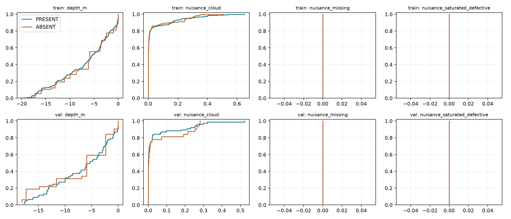

# Final reusable Clay models

Two models are fitted on the complete 725-chip selected union: **small MLP, pool 5** and **original MLP, pool 1**. All 513 PRESENT and 212 ABSENT chips are retained. Both models use the same grouped train/validation split.

## Partitions

| Partition | PRESENT | ABSENT | Total |
| --- | ---: | ---: | ---: |
| Train | 436 | 180 | 616 |
| Validation | 77 | 32 | 109 |

Observation IDs, identical arrays and connected locations within 50 m stay together. The split balances depth and whole-chip cloud/shadow/cirrus, missing and defective fractions, including both class differences and validation representativeness. Spectral appearance, acquisition and processing variables do not enter its objective. All chips are retained, so the class ratio follows the selected union rather than exactly 2:1. Training replays the included split exactly. Independent land and glint measurements remain unavailable. The partition optimizer reports a relative objective gap of 43.9%; the measured balance is not proof of global optimality.

Validation selects checkpoints and thresholds; it is not an independent test. The union has already been explored in model comparisons, so these are fitting diagnostics, not new estimates of generalization. The [three-seed comparison](../full_nuisance_balance/README.md) remains the classifier comparison.

## Models and selection

Clay v1.5 remains frozen and encodes the full chip with derived GSD 128 × 10 / 224 ≈ 5.714 m. The heads receive CLS concatenated with centrally pooled patch tokens. The original MLP is 2048 → 512 → 128 → 1; the small MLP is 2048 → 32 → 1. Both use seed 42, focal loss, Adam learning rate 0.001, batch size 64, at most 100 epochs and patience 25. Original-MLP weight decay is fixed at 0.0001; small-MLP weight decay is selected from 0.1, 0.01 and 0.0001 on validation Macro F1 at 0.5. Thresholds are then selected on validation over 0.05–0.95 in steps of 0.01.

| Model | Best epoch | Weight decay | Decision threshold |
| --- | ---: | ---: | ---: |
| small_mlp_pool5 | 24 | 0.0001 | 0.50 |
| mlp_pool1 | 21 | 0.0001 | 0.53 |

| Model | Split | PRESENT precision | PRESENT recall | ABSENT precision | ABSENT recall | Macro F1 |
| --- | --- | ---: | ---: | ---: | ---: | ---: |
| small_mlp_pool5 | train | 0.984 | 0.961 | 0.911 | 0.961 | 0.954 |
| small_mlp_pool5 | val | 0.852 | 0.974 | 0.905 | 0.594 | 0.813 |
| mlp_pool1 | train | 1.000 | 1.000 | 1.000 | 1.000 | 1.000 |
| mlp_pool1 | val | 0.892 | 0.961 | 0.885 | 0.719 | 0.859 |

## Balance

| Partition | Feature | Class KS distance |
| --- | --- | ---: |
| train | depth_m | 0.103 |
| train | nuisance_cloud | 0.056 |
| train | nuisance_missing | 0.000 |
| train | nuisance_saturated_defective | 0.000 |
| val | depth_m | 0.150 |
| val | nuisance_cloud | 0.137 |
| val | nuisance_missing | 0.000 |
| val | nuisance_saturated_defective | 0.000 |



## Reproduction and reuse

[Selected chips](selected.csv), [split](split.json), [split protocol](split_protocol.json), [metrics](metrics.csv), [model catalog](model_manifest.json) identify the reusable models. Binary checkpoints are excluded from Git; paths and external inputs are described in [example_config.json](../../example_config.json).

Configure a fresh FINAL_MODELS_DIR and the full-chip embedding cache configured as FULL_NUISANCE_EMBEDDINGS, then run:

```sh
python training/train_final_models.py
python training/verify_final_models.py
python training/summarize_final_models.py
```

For reuse, [final_model_io.py](../final_model_io.py) provides `load_head(path, device)` and `predict_embeddings(model, checkpoint, embeddings)`. Supply N×2048 embeddings from the recorded frozen encoder, normalization and matching central pool. The returned labels use the saved validation-selected threshold. Each checkpoint includes architecture, pool, threshold, encoder settings/hashes and the training-manifest/split hashes. `FINAL_CHECKPOINTS_DIR` resolves the relative model paths in the catalog.
