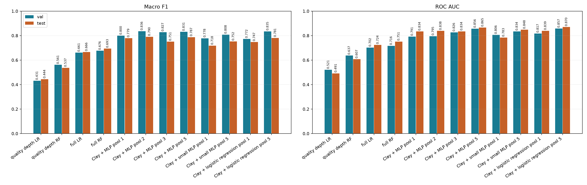
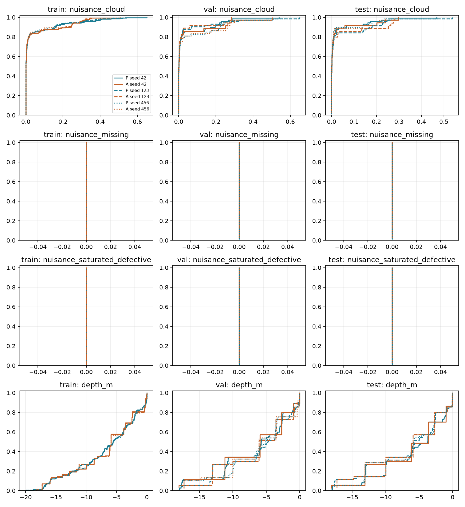

# Whole-chip nuisance balancing

Clay encodes the full native 128×128 chip, resized to 224×224. Encoder GSD is derived as 128 × 10 / 224 ≈ 5.714 m; the native footprint remains 1,280 m. The MLP receives the global CLS token concatenated with the average of the selected central patch tokens (pools 1, 2, 3 and 5). Central pooling happens after full-image encoding. Clay is frozen; time/location inputs are constant zeros.

## Selection and baselines

The starting pool has 984 PRESENT and 214 ABSENT chips. Central 5×5 quality exclusion leaves 984 PRESENT and 212 ABSENT candidates. We retain all 212 eligible ABSENT chips, repartition their spatial/observation/duplicate groups, then select 424 PRESENT chips for each seed at 2:1 in every partition. Matching uses observation depth and full-chip SCL cloud/shadow/cirrus, missing-data and saturated/defective fractions. Whole-chip flags are matched, not used as a zero-tolerance exclusion.

Spectral brightness, colour, texture, SCL land/water fractions, acquisition dates and processing metadata do not enter matching. Independent land-overlap and reliable sunglint measurements are unavailable: this experiment does not establish control of all confounders. Existing acquisition filters remain inherited. Each ABSENT observation supplies images from up to eight different acquisition dates within ±30 days. No observation has duplicate acquisition dates. These images share one field label/location and remain grouped in the same partition.

LR means logistic regression: a linear decision rule on the supplied features. RF means random forest: an ensemble of decision trees that can capture nonlinear relationships. Baseline LR/RF use image statistics or nuisance measurements; Clay + logistic regression uses frozen Clay embeddings. Whole-chip image baselines use mean, standard deviation, 10th/90th percentiles and their difference for all pixels in each of the same six bands Clay receives. These baseline predictors are not matching variables. The nuisance baseline uses only depth and the three quality fractions. Baselines use fixed hyperparameters and threshold 0.5; each Clay checkpoint and threshold is chosen using validation only. These are exploratory partitions, not untouched external validation.

## Classifier results

Three-seed means. Every model uses the same selected chips and partitions. All pool results are shown; no pool is selected using test performance.

| Model | Validation Macro F1 | Validation AUC | Test Macro F1 | Test AUC |
| --- | ---: | ---: | ---: | ---: |
| quality depth LR | 0.431 | 0.521 | 0.444 | 0.491 |
| quality depth RF | 0.561 | 0.637 | 0.537 | 0.607 |
| full LR | 0.661 | 0.702 | 0.666 | 0.724 |
| full RF | 0.676 | 0.716 | 0.693 | 0.751 |
| Clay + MLP pool 1 | 0.800 | 0.791 | 0.779 | 0.834 |
| Clay + MLP pool 2 | 0.836 | 0.795 | 0.790 | 0.838 |
| Clay + MLP pool 3 | 0.827 | 0.826 | 0.751 | 0.834 |
| Clay + MLP pool 5 | 0.831 | 0.856 | 0.787 | 0.865 |
| Clay + small MLP pool 1 | 0.778 | 0.806 | 0.718 | 0.783 |
| Clay + small MLP pool 5 | 0.808 | 0.834 | 0.752 | 0.848 |
| Clay + logistic regression pool 1 | 0.772 | 0.817 | 0.747 | 0.839 |
| Clay + logistic regression pool 5 | 0.835 | 0.857 | 0.781 | 0.870 |



| Clay pool | Split | PRESENT precision | PRESENT recall | ABSENT precision | ABSENT recall | Macro F1 |
| --- | --- | ---: | ---: | ---: | ---: | ---: |
| 1 | train | 0.998 | 1.000 | 1.000 | 0.995 | 0.998 |
| 1 | val | 0.843 | 0.922 | 0.803 | 0.654 | 0.800 |
| 1 | test | 0.828 | 0.916 | 0.785 | 0.616 | 0.779 |
| 2 | train | 1.000 | 1.000 | 1.000 | 1.000 | 1.000 |
| 2 | val | 0.852 | 0.968 | 0.911 | 0.662 | 0.836 |
| 2 | test | 0.826 | 0.948 | 0.846 | 0.597 | 0.790 |
| 3 | train | 0.990 | 0.999 | 0.998 | 0.979 | 0.991 |
| 3 | val | 0.846 | 0.968 | 0.910 | 0.644 | 0.827 |
| 3 | test | 0.812 | 0.913 | 0.777 | 0.569 | 0.751 |
| 5 | train | 1.000 | 1.000 | 1.000 | 1.000 | 1.000 |
| 5 | val | 0.854 | 0.955 | 0.879 | 0.672 | 0.831 |
| 5 | test | 0.829 | 0.939 | 0.828 | 0.606 | 0.787 |

## Simpler Clay heads

Logistic regression (2,049 parameters) and a 2048 → 32 → 1 MLP (65,601 parameters) use the same full-chip embeddings and partitions, for pools 1 and 5. Logistic C and small-MLP weight decay are selected by validation Macro F1 at 0.5, followed by validation-only threshold selection. No test results select regularization. [Runner](../train_simple_clay_heads.py), [metrics](simple_heads/metrics.csv), [selection candidates](simple_heads/validation_candidates.csv) and [protocol](simple_heads/protocol.json).

| Model | Split | PRESENT precision | PRESENT recall | ABSENT precision | ABSENT recall | Macro F1 |
| --- | --- | ---: | ---: | ---: | ---: | ---: |
| Clay + small MLP pool 1 | train | 0.930 | 0.914 | 0.837 | 0.864 | 0.886 |
| Clay + small MLP pool 1 | val | 0.840 | 0.873 | 0.738 | 0.671 | 0.778 |
| Clay + small MLP pool 1 | test | 0.802 | 0.874 | 0.674 | 0.554 | 0.718 |
| Clay + small MLP pool 5 | train | 0.918 | 0.964 | 0.913 | 0.810 | 0.893 |
| Clay + small MLP pool 5 | val | 0.848 | 0.928 | 0.842 | 0.662 | 0.808 |
| Clay + small MLP pool 5 | test | 0.812 | 0.929 | 0.791 | 0.553 | 0.752 |
| Clay + logistic regression pool 1 | train | 0.972 | 0.981 | 0.960 | 0.943 | 0.964 |
| Clay + logistic regression pool 1 | val | 0.838 | 0.864 | 0.726 | 0.670 | 0.772 |
| Clay + logistic regression pool 1 | test | 0.815 | 0.907 | 0.742 | 0.573 | 0.747 |
| Clay + logistic regression pool 5 | train | 1.000 | 1.000 | 1.000 | 1.000 | 1.000 |
| Clay + logistic regression pool 5 | val | 0.874 | 0.918 | 0.826 | 0.734 | 0.835 |
| Clay + logistic regression pool 5 | test | 0.837 | 0.921 | 0.794 | 0.626 | 0.781 |

Original MLP pool 5 has mean validation Macro F1 0.831, test Macro F1 0.787. Depth/quality RF test Macro F1 is 0.537; the always-PRESENT baseline is 0.400. Measured nuisance predictability must be considered when interpreting performance. With 420–420 training chips and about 1.1 million trainable parameters in the original MLP, overfitting is possible. Shared scenes, overlapping footprints and repeated test inspection also limit generalization claims. The full selected union also supports the [two final reusable models](../final_models/README.md), fitted on a separate train/validation split.

## Distribution balance

Mean class KS distance across three seeds; smaller means closer marginal distributions. Only the current selected partitions are shown.

| Feature | Split | KS |
| --- | --- | ---: |
| nuisance_cloud | train | 0.044 |
| nuisance_cloud | val | 0.069 |
| nuisance_cloud | test | 0.061 |
| nuisance_missing | train | 0.000 |
| nuisance_missing | val | 0.000 |
| nuisance_missing | test | 0.000 |
| nuisance_saturated_defective | train | 0.000 |
| nuisance_saturated_defective | val | 0.000 |
| nuisance_saturated_defective | test | 0.000 |
| depth_m | train | 0.102 |
| depth_m | val | 0.110 |
| depth_m | test | 0.112 |



## Reproduction

Configure the inputs and outputs described and linked in [example_config.json](../../example_config.json), overriding defaults in untracked config.json and using fresh output directories.

```sh
python training/prepare_nuisance_pool.py
python training/balance_absent_first.py
python training/train_frozen_sesimbra.py --pools 1 2 3 5
python training/train_simple_clay_heads.py
python training/verify_full_nuisance_trial.py
python training/verify_simple_clay_heads.py
python training/build_model_catalog.py
python training/summarize_full_nuisance_trial.py
```

[Seed-aware chip manifest](selected.csv), [split counts](split_counts.csv), [selection protocol](protocol.json), [baseline results](baseline_metrics.csv) (`variant=balanced`), [Clay results](clay_full_sweep/metrics.csv), [Clay predictions](clay_full_sweep/predictions.csv), [Clay protocol](clay_full_sweep/protocol.json), and [feature balance](feature_balance.csv). The 24 trained classifier models are excluded from Git. The [model catalog](../model_manifest.json) records hashes and paths relative to CHECKPOINTS_DIR. Checkpoints, other external inputs and generated caches are described and linked in [example_config.json](../../example_config.json).
